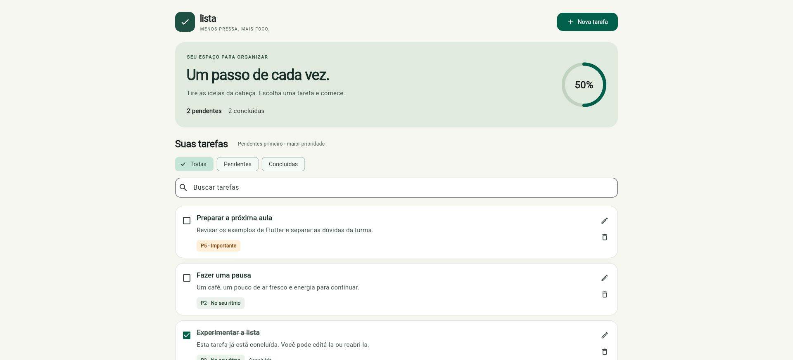

# Lista — Flutter Task Planner

[](https://docs.flutter.dev/)
[](https://dart.dev/)
[](https://github.com/kleberandrade/todo-list-aulas-flutter/actions/workflows/flutter.yml)
[](LICENSE)

An offline task planner and classroom example by **Kleber de Oliveira Andrade**. Create, edit, complete, reopen, and delete everyday tasks, with durable SQLite storage and immediate undo. The interface is in Brazilian Portuguese; this repository documentation is in English.



## Run locally

Verified toolchain: **Flutter 3.50.0 / Dart 3.14.0**. The manifest requires Flutter >=3.50.0 and Dart >=3.14.0 <4.0.0. The committed lockfile records the resolved versions. All direct registry packages and all resolvable transitive packages were refreshed; two upstream SDK pins remain as documented in [the dependency audit](docs/DEPENDENCIES.md). Install/select Flutter 3.50.0 before running these commands; the old globally installed SDK does not satisfy this project anymore.

```sh
git clone https://github.com/kleberandrade/todo-list-aulas-flutter.git
cd todo-list-aulas-flutter
flutter pub get --enforce-lockfile
# Generates the SQLite worker and its matching WASM binary; first run may take minutes.
dart run sqflite_common_ffi_web:setup
flutter run -d chrome --web-port 8765
```

Keep the same host and port to reopen the same browser database. Web storage belongs to the browser origin and is separate from native application storage. Clearing site data, using a different browser/profile, or changing the origin will not retain that database. The SQLite Web adapter persists data in IndexedDB; multi-tab synchronization of the visible list is not provided. There is no server, account, cloud sync, or telemetry in application code. Initial Web asset loading requires serving the build; this project does not promise an offline-installable PWA.

For native development:

```sh
flutter run -d macos
# With an available configured device/simulator:
flutter devices
flutter run -d <device-id>
```

The regenerated platform projects retain Android `com.example.todo_list` and iOS `com.example.todoList`, preserving the application data sandbox when upgrading with the same signing identity. Platform baselines: Android uses Flutter's supported SDK defaults, iOS 15+, macOS 12+. Android development requires its SDK/JDK and accepted licenses; iOS/macOS require Xcode and CocoaPods. Distribution signing is not configured (Android release currently uses the template debug key). Do not uninstall an existing native app to migrate its data.

## Features and controls

- Choose **Nova tarefa** to open a validated form. Title: 1–120 trimmed characters; description: up to 2000 characters, including line breaks; priority: 1–5 (5 is highest).
- Use the checkbox to complete/reopen, the pencil to edit, and the trash button to delete. All actions have visible controls/tooltips and support keyboard focus; Tab traverses controls and Enter/Space activates focused buttons.
- Choose **Desfazer** in the deletion notification to restore the original record, ID and completion status. Undo is available while that notification is present; it is not a persistent trash bin.
- Filter by **Todas**, **Pendentes**, or **Concluídas** and search title/description (case-insensitive). Ordering is pending first, then descending priority, then ascending ID for stable ties. The progress summary always counts the full list.
- The empty state offers **Experimentar exemplos**, adding three local classroom tasks only when the database is empty. Examples are never automatically inserted over user data.
- Forms preserve drafts after write failure. Loading, saving, empty results, and storage errors have explicit states and retry controls. The layout wraps on narrow screens, accommodates enlarged text, and limits reading width on desktop.

## Architecture and glossary

`Task` is an immutable domain value. A draft has no ID; SQLite assigns the ID when it is saved. Priority 5 is highest. A completed task can be reopened. `TaskStore` is the persistence contract, `TaskRepository` owns SQL and migration, and `TaskController` owns presentation state and serialized user writes. Widgets render state and collect input; they do not execute SQL.

- `lib/models/task.dart`: validation and legacy row decoding.
- `lib/data/task_repository.dart`: schema, CRUD, stable ordering, examples, restoration and retryable opening.
- `lib/data/platform_native.dart` / `platform_web.dart`: native SQLite / IndexedDB-backed SQLite selection through a conditional import.
- `lib/state/task_controller.dart`: filters, search, progress, busy/error state and success-after-write behavior.
- `lib/views/`: home, task card and scrollable form dialog. Material 3 components replace obsolete Slidable/Flushbar APIs.

## Existing data and migration

The database remains **`todo_list.db`**, table **`task`**. On opening an original version-1 database, SQLite transactionally migrates to version 2, copying the original `id`, `title`, `description` and `isDone` fields into an equivalent table with `priority` defaulting to 3 and `AUTOINCREMENT` IDs. The table replacement preserves original IDs and nullable fields, while preventing a new task from reusing an ID still offered for undo. The transaction rolls back on failure; the application does not reset or delete a database it cannot read.

Legacy null/blank titles display as **Tarefa sem título** and null descriptions display as empty. Original oversized text remains readable; editing requires satisfying the new limits. A version-1 fixture is upgraded in a real file-backed SQLite test and reopened. Native database files are not automatically imported into the independent browser database. Schema downgrade to the 2019 application is unsupported; back up native app data before upgrading if you need to retain a copy for that older app.

## Verification

```sh
dart format --output=none --set-exit-if-changed lib test
flutter analyze
flutter test --coverage
dart run sqflite_common_ffi_web:setup
flutter build web --release --no-wasm-dry-run
flutter build macos --release
# Requires an appropriately configured Apple toolchain; no signing in this command:
flutter build ios --release --no-codesign
```

The Web command builds the JavaScript Flutter target; `--no-wasm-dry-run` skips the unrelated optional Flutter Wasm compatibility probe. SQLite itself still uses its generated WASM binary. Regenerate the worker/binary together after changing their package versions; generated Web binaries are ignored in Git and rebuilt in CI.

The current Flutter 3.50.0 toolchain builds the universal macOS target (arm64 + x86_64) without the older single-architecture workaround. The upgrade initially found stale Xcode precompiled headers; only this project's generated build/workspace caches were cleared before rebuilding. Intel runtime testing is not claimed. Flutter generated its supported Swift Package integration while retaining the existing custom CocoaPods configuration; both Apple release builds were verified.

Tests cover domain boundaries, old database migration, reopen persistence, ordering, edit/complete/delete/restore, ID collision prevention, failed-open retry, examples, controller errors and concurrent writes, widget CRUD/undo, form validation/draft recovery, and narrow layouts at 150% text size. The deliberately invalid-database test prints an expected SQLite error while testing recovery; this does not indicate a passing test was skipped.

The `Flutter` workflow on `master` and pull requests runs formatting, analysis, tests/coverage, worker generation and the Web release build, and uploads the resulting build and LCOV as artifacts. Read its actual run for current results; no coverage badge or passing status is hard-coded. `crapper`, `dryer` and `mutator` were inspected but do not support Dart, so no scores from those tools are reported.

See [verification notes](docs/VALIDATION.md), the [action log](docs/WORK_LOG.md), and actual application screenshots in `docs/screenshots/` for measured results and platform limitations.

## Classroom article and credits

Original Portuguese tutorial: [Criando uma Lista de Tarefas com Flutter](https://medium.com/flutter-comunidade-br/criando-uma-lista-de-tarefas-com-flutter-fc81fa2bac6a) ([original short link](http://bit.ly/2jXXU7Q)). It was opened and read during modernization. The article's original challenges—validation, multiline description, priority and completion progress—are now implemented. Further exercises: alternate sorting with tests, non-destructive import/export, or persistent trash with recovery rules.

The Portuguese tutorial was updated and republished at its original URL with a new original editorial cover, real application images, two diagrams, explained implementation excerpts and five progressive exercises. The complete source is in [docs/medium-update.pt-BR.md](docs/medium-update.pt-BR.md); see [publication notes](docs/MEDIUM_PUBLICATION.md) for the verified publication status. Its original identity, language, teaching purpose and third-party references are preserved.

Original reference material remains useful as historical reading:

- [Flutter: Persist data with SQLite](https://docs.flutter.dev/cookbook/persistence/sqlite)
- [Using SQLite in Flutter](https://medium.com/flutter-community/using-sqlite-in-flutter-187c1a82e8b)
- [SQFlite Database in Flutter](https://medium.com/@mohamedraja_77/sqflite-database-in-flutter-c0b7be83bcd2)
- [SQLite MVP app video](https://www.youtube.com/watch?v=Yzfxqd9-6QY)
- [Adding SQLite for offline support video](https://www.youtube.com/watch?v=zEqH2qYs7Pg)

Copyright **2019 Kleber de Oliveira Andrade**. [MIT License](LICENSE) is unchanged. Flutter-generated platform templates/icons and dependencies retain their upstream licenses; no third-party article content has been relicensed. New interface elements are rendered with Flutter components, without stock imagery or custom remote-font dependencies.
