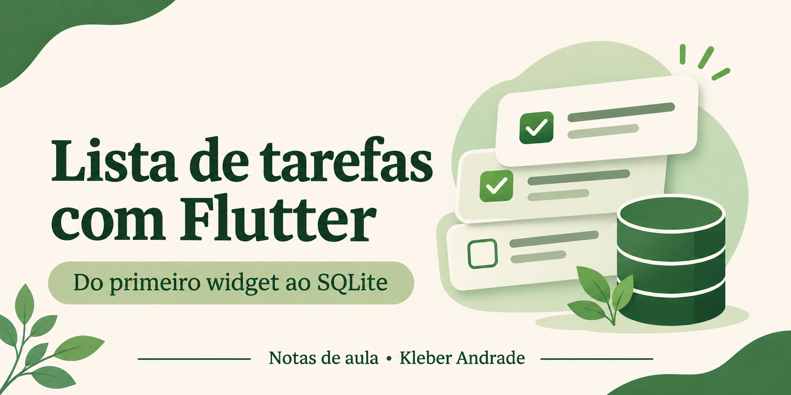
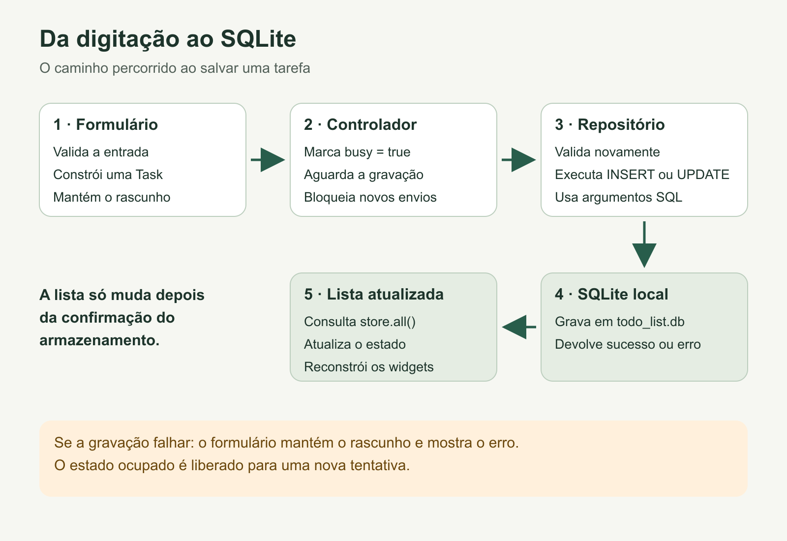
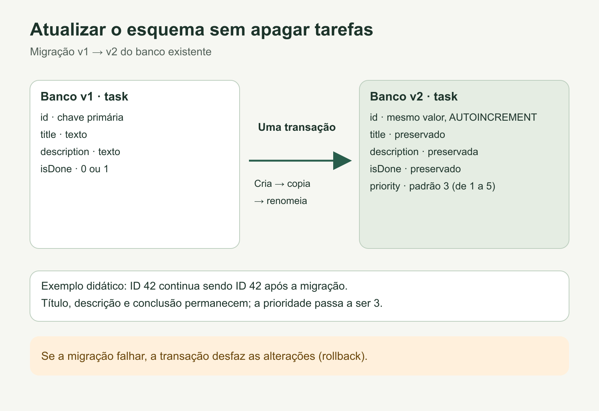
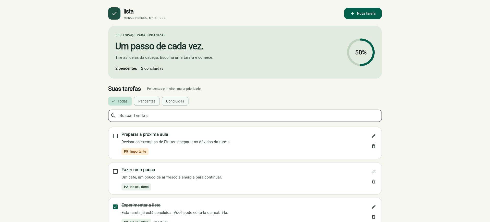

# Criando uma Lista de Tarefas com Flutter

Notas de aula do prof. Kleber de Oliveira Andrade



Uma lista de tarefas é um ótimo projeto para entender o caminho completo entre o que a pessoa digita, o que aparece na tela e o que fica salvo no dispositivo. Neste tutorial, vamos percorrer esse caminho com Flutter e SQLite, em passos pequenos e verificáveis.

A ideia de priorizar uma tarefa por vez, presente na história de Ivy Lee que abriu estas notas em 2019, continua sendo o ponto de partida. Agora vamos transformá-la em um aplicativo que também continua funcionando depois de fechado e aberto novamente.

**O que você vai aprender:** representar uma tarefa, validar um formulário, gravar e consultar dados locais, organizar o estado da tela e testar os comportamentos importantes. Ao final, você encontrará cinco exercícios em ordem crescente de dificuldade.

**Antes de começar:** é útil conhecer variáveis, funções, classes e widgets básicos de Dart/Flutter. Não precisamos de servidor, conta de usuário ou serviço de autenticação.

## 1. Execute primeiro e descubra o que vamos construir

Esta edição foi revisada para **Flutter 3.50.0 e Dart 3.14.0**. O código continua no mesmo repositório do artigo original:

```sh
git clone https://github.com/kleberandrade/todo-list-aulas-flutter.git
cd todo-list-aulas-flutter
flutter --version
flutter pub get --enforce-lockfile
```

Confira a saída de `flutter --version` antes de continuar. Ter uma versão nova de um pacote não significa que ela funcione em qualquer versão do Dart. Os pacotes SQLite atuais usados aqui já exigem um SDK mais recente que o Dart 3.11 das primeiras revisões.

Se você trabalha com projetos antigos, mantenha o SDK deste tutorial em uma instalação separada e use o caminho completo para `flutter` e `dart`, ou configure o PATH apenas no terminal deste projeto. Assim, você pode experimentar a atualização sem mudar o ambiente dos outros aplicativos.

No Chrome, prepare os arquivos do SQLite Web e execute:

```sh
dart run sqflite_common_ffi_web:setup
flutter run -d chrome --web-port 8765
```

O comando de preparação gera `web/sqlite3.wasm` e `web/sqflite_sw.js`. O primeiro contém o SQLite compilado para o navegador; o segundo executa o trabalho do banco em um worker. Eles precisam acompanhar o build. Gere os dois novamente ao atualizar o adaptador ou o SQLite.

**Primeira conferência:** crie uma tarefa, feche o formulário e recarregue a página. Ela deve continuar na lista. Depois teste o lápis para editar, o checkbox para concluir e a lixeira para excluir. O aviso de exclusão oferece **Desfazer**.

Mantenha o mesmo navegador, perfil, endereço e porta para reencontrar o banco Web. `localhost` e `127.0.0.1` são origens diferentes; trocar a porta também muda a origem. Limpar os dados do site remove o armazenamento local. Não há sincronização automática entre Web, Android, iOS e macOS.

A versão nativa pode ser executada com `flutter run -d macos`, ou em um dispositivo configurado listado por `flutter devices`. Um build iOS sem assinatura não equivale a executar em um iPhone. Consulte o README para os requisitos e resultados de plataforma verificados.

## 2. Entenda os pacotes e a mudança do Material

O trecho principal do `pubspec.yaml` é:

```yaml
environment:
  sdk: '>=3.14.0 <4.0.0'
  flutter: '>=3.50.0'
dependencies:
  flutter:
    sdk: flutter
  material_ui: ^1.11.1
  cupertino_icons: ^2.0.0
  path: ^1.9.1
  sqflite: ^2.4.6
  sqflite_common: ^2.5.17
  sqflite_common_ffi_web: ^1.2.2
dev_dependencies:
  flutter_test:
    sdk: flutter
  flutter_lints: ^6.0.0
  sqflite_common_ffi: ^2.4.7
```

Pense nas responsabilidades de cada grupo:

- **Interface:** `material_ui` oferece os componentes Material atuais. `cupertino_icons` fornece os ícones usados por controles adaptativos.
- **Persistência:** `sqflite` integra o banco nativo; `sqflite_common` define a API compartilhada; `sqflite_common_ffi_web` permite usá-la no navegador.
- **Verificação:** `flutter_test` testa domínio, estado e widgets; `sqflite_common_ffi` permite abrir um SQLite real nos testes do computador. `path` ajuda a compor os caminhos dos bancos temporários desses testes.
- **Análise:** `flutter_lints` aponta problemas e orienta a consistência do código.

No Flutter 3.50, as bibliotecas de design foram separadas do núcleo do SDK. Neste projeto usamos:

```dart
import 'package:material_ui/material_ui.dart';
```

As traduções Material também vêm desse pacote. Em `MaterialApp`, usamos `GlobalMaterialLocalizations.delegates` e a localidade `pt_BR`. Não misture widgets e tipos importados da biblioteca antiga com os do pacote novo. A [documentação oficial da migração](https://docs.flutter.dev/release/breaking-changes/material-ui-and-cupertino-ui) explica a transição.

Outro detalhe desta atualização é `DropdownButtonFormField.enabled`: o formulário usa `enabled: !_saving` para bloquear a prioridade enquanto salva. Não dependemos somente de deixar `onChanged` nulo.

O `pubspec.lock` registra as versões exatas resolvidas. Dois pacotes transitivos, `material_color_utilities` e `test_api`, permanecem nas versões fixadas pelo Flutter 3.50.0. Não usamos `dependency_overrides` para ultrapassar essas restrições. Consulte `docs/DEPENDENCIES.md` para conferir a auditoria.

## 3. Separe as responsabilidades antes de seguir o código

A estrutura principal é pequena:

```text
lib/
  main.dart
  models/task.dart
  data/task_repository.dart
  data/platform_native.dart
  data/platform_web.dart
  state/task_controller.dart
  views/home_page.dart
  views/task_dialog.dart
  views/task_card.dart
```

Uma forma de ler esse projeto é fazer uma pergunta para cada parte:

**Modelo:** o que é uma tarefa válida? **Repositório:** como gravamos e lemos essa tarefa? **Controlador:** quais dados e estados a tela precisa mostrar? **Widgets:** como a pessoa interage com esses dados?

Essa separação permite testar o banco sem abrir uma tela e testar a tela sem depender de um banco real em todos os testes. A inicialização cria uma instância do armazenamento e passa a mesma instância ao controlador; não precisamos espalhar um singleton global pelo aplicativo.

O import condicional em `main.dart` escolhe o adaptador nativo ou o Web. O restante do código trabalha com a interface `TaskStore`, sem precisar saber onde o SQLite está sendo executado.



Fluxo de dados: da tela ao SQLite e de volta para a lista.

## 4. Modele uma tarefa válida

No arquivo `lib/models/task.dart`, `Task` representa uma tarefa com cinco informações: ID, título, descrição, conclusão e prioridade.

```dart
final task = Task(
  title: 'Preparar a próxima aula',
  description: 'Revisar o exemplo.\nSeparar as dúvidas da turma.',
  priority: 5,
);
```

`final` impede reatribuir a variável. Os campos da tarefa também são imutáveis: editar significa construir um novo valor, sem alterar antecipadamente o objeto que já aparece na lista.

O ID é `int?`: o ponto de interrogação permite `null` enquanto a tarefa ainda não foi inserida. Depois, o SQLite fornece o identificador. O título é obrigatório; a descrição começa vazia; a tarefa começa pendente e com prioridade 3. A prioridade vai de 1 a 5, sendo 5 a maior.

As regras de entrada são claras: o título não pode conter só espaços e aceita até 120 caracteres; a descrição aceita até 2000 caracteres e várias linhas. O construtor remove espaços das extremidades. Uma entrada inválida gera erro, em vez de criar silenciosamente um estado que o restante do aplicativo não sabe tratar.

Para representar a conclusão, preservando as outras informações:

```dart
final completed = task.copyWith(isDone: true);
```

Compare os objetos: `task.isDone` continua falso, enquanto `completed.isDone` é verdadeiro. Essa diferença ajuda a manter previsível a relação entre o estado da tela e o que foi efetivamente gravado.

No SQLite, o booleano é armazenado como 0 ou 1. `toMap()` faz a conversão para a linha do banco; `Task.fromMap()` faz o caminho de volta. A leitura também reconhece registros antigos com campos nulos, exibindo “Tarefa sem título” ou descrição vazia sem excluir a tarefa.

Veja a regra real usada por Task e pelo formulário. Este método fica dentro da classe Task:

```dart
static String? validateTitle(String? value) {
    if (value == null || value.trim().isEmpty) return 'Informe um título.';
    if (value.trim().length > 120) return 'Use até 120 caracteres no título.';
    return null;
  }
```

Retornar uma mensagem significa que a entrada é inválida; retornar null significa que ela passou pela regra. O construtor de Task transforma uma mensagem em ArgumentError, enquanto o formulário a apresenta junto ao campo. Assim, o mesmo critério não precisa ser reescrito em cada tela.

## 5. Siga uma gravação, do botão até o banco

Abra `lib/views/task_dialog.dart`. O formulário usa `Form`, `TextFormField` e validadores. Ao tocar em **Salvar tarefa**, o fluxo é:

1. O formulário verifica as entradas e mostra o erro junto ao campo, se necessário.
2. Com os dados válidos, construímos uma `Task` e pedimos ao controlador para salvar.
3. O controlador marca a operação como ocupada e aguarda o repositório.
4. O repositório confirma a gravação no SQLite e a lista é lida novamente.
5. Só depois desse sucesso o formulário é fechado e a lista atualizada.

`Future` representa um resultado que ainda vai chegar; `await` espera esse resultado antes de seguir. Não é preciso supor que uma gravação deu certo só porque o botão foi pressionado.

Se o armazenamento falhar, o rascunho permanece no formulário e a mensagem permite tentar novamente. Enquanto salva, o formulário e as novas gravações ficam bloqueados. Os `TextEditingController` são descartados em `dispose`, pois não devem continuar vivos depois que o formulário saiu da tela.

**Experimente:** envie um título vazio. A mensagem “Informe um título.” deve aparecer. Digite um título, uma descrição com duas linhas e escolha outra prioridade. Depois de salvar, abra a edição e confira os três valores.

Este é o campo de título real de TaskDialog. O trecho faz parte do widget e usa o controlador _title e o estado _saving definidos na classe:

```dart
TextFormField(
  controller: _title,
  autofocus: true,
  enabled: !_saving,
  decoration: const InputDecoration(
    labelText: 'Título',
    hintText: 'O que você quer fazer?',
  ),
  textCapitalization: TextCapitalization.sentences,
  validator: Task.validateTitle,
  textInputAction: TextInputAction.next,
)
```

controller lê o texto digitado; autofocus coloca o foco inicial nesse campo; enabled bloqueia mudanças enquanto salva; validator reutiliza a regra de Task. textInputAction.next permite avançar para o próximo campo pelo teclado. A imagem a seguir mostra esse formulário em funcionamento.


Formulário real em largura de celular: título obrigatório, descrição multilinha e prioridade de 1 a 5.

## 6. Grave, consulte, edite e restaure no SQLite

`lib/data/task_repository.dart` concentra o SQL. O exemplo abaixo usa a variável `repository` para representar a instância de `TaskRepository` criada pelo aplicativo; ele demonstra as chamadas, não é um arquivo completo para executar sozinho.

```dart
final saved = await repository.save(Task(title: 'Estudar SQLite'));

await repository.save(Task(
  id: saved.id,
  title: 'Estudar SQLite com Flutter',
  description: 'Praticar consultas parametrizadas.',
  priority: 4,
));

final tasks = await repository.all();
```

Sem ID, `save` insere uma linha e devolve a tarefa com o identificador atribuído. Com ID, atualiza a linha correspondente e verifica se ela realmente existia. As condições usam `where: 'id = ?'` e `whereArgs`, em vez de montar SQL concatenando o texto digitado.

A ordem da consulta é `isDone ASC, priority DESC, id ASC`. Leia da esquerda para a direita: pendentes antes das concluídas; dentro de cada grupo, prioridade maior primeiro; em caso de empate, menor ID primeiro. O controlador preserva essa ordem ao combinar os filtros com a busca.

Para excluir e recuperar a mesma tarefa:

```dart
await repository.delete(saved.id!);
await repository.restore(saved);
```

Aqui, o `!` é usado porque `saved` veio de uma gravação concluída e já tem ID. Ele não deve ser espalhado pelo código para esconder a possibilidade de valores nulos.

O desfazer agora reinserta o registro com seu ID original. O código de 2019 tentava atualizar uma linha que já havia sido excluída; a tela podia sugerir uma recuperação que não sobrevivia à reabertura. Repetir a restauração não cria uma segunda linha. O aviso permite desfazer enquanto está disponível, mas não existe uma lixeira persistente na versão base.

A consulta que gera a lista também é pequena. Este é o método all() real de TaskRepository; _database é a abertura assíncrona do banco da mesma classe:

```dart
Future<List<Task>> all() async => (await (await _database).query(
    'task',
    orderBy: 'isDone ASC, priority DESC, id ASC',
  )).map(Task.fromMap).toList();
```

query pede as linhas já ordenadas ao SQLite. map(Task.fromMap) transforma cada linha em uma Task; toList reúne os resultados em uma lista. O await impede que o controlador tente usar as linhas antes de a consulta terminar.

## 7. Atualize o banco sem perder as tarefas antigas

O arquivo continua se chamando `todo_list.db` e a tabela continua `task`. Os identificadores nativos do aplicativo também foram mantidos. Não desinstale o aplicativo para atualizar se quiser preservar seus dados locais.

Ao abrir um banco da versão 1, o repositório migra para a versão 2 dentro de uma transação. IDs, títulos, descrições e conclusão são copiados; a prioridade recebe 3. A tabela usa `AUTOINCREMENT`, evitando que uma tarefa nova reutilize o ID de uma tarefa recém-excluída que ainda pode ser restaurada.

Uma transação trata o conjunto de alterações como uma unidade: se a atualização falhar, não queremos deixar metade da migração aplicada. Os testes criam um arquivo na estrutura antiga, abrem com o código atual, fecham e abrem novamente para conferir os registros. A aplicação não apaga um banco que não conseguiu ler.

Os registros antigos que ultrapassam os limites novos continuam legíveis; ao editar, é necessário ajustá-los às regras atuais. O banco nativo não é importado automaticamente para o navegador. São armazenamentos independentes.



Migração real do projeto: os registros da versão 1 são preservados e recebem prioridade 3 na versão 2.

## 8. Organize a tela e confira o resultado

`TaskController` reúne carregamento, gravação, erro, busca, filtro e progresso. `HomePage` monta o resumo e a lista; `TaskCard` apresenta cada tarefa; `TaskDialog` recebe os dados de criação ou edição.

Na tela, **Todas**, **Pendentes** e **Concluídas** podem ser combinadas com a busca por título ou descrição. A busca ignora diferenças entre maiúsculas e minúsculas. O progresso considera a lista completa, mesmo quando um filtro mostra apenas parte dela.

Os botões de editar e excluir ficam visíveis, sem exigir que a pessoa descubra um gesto de arrastar. Cada checkbox tem uma ação própria para leitores de tela; os outros controles não ficam agrupados dentro dele. O formulário recebe foco inicial no título e permite seguir com Tab. Cores, espaçamento e textos de estado ajudam a entender o que aconteceu.

Na lista vazia, **Experimentar exemplos** adiciona três tarefas locais. Elas só são inseridas quando o banco está vazio e a pessoa escolhe essa ação; não substituem dados existentes.

**Roteiro rápido de conferência:** crie duas tarefas com prioridades diferentes, conclua uma, combine busca e filtros, edite a outra, exclua e desfaça. Feche e abra novamente. A ordem, a conclusão, o título e a descrição precisam continuar corretos.



## 9. Use os testes como parte da aula

Execute:

```sh
dart format --output=none --set-exit-if-changed lib test
flutter analyze
flutter test --coverage
dart run sqflite_common_ffi_web:setup
flutter build web --release --no-wasm-dry-run
```

Os testes verificam comportamento: entrada inválida, migração de registros antigos, reabertura do banco, ordem da lista, restauração, falhas de armazenamento e interação com widgets. Um teste do seletor de prioridade também protege a mudança de API encontrada nesta atualização.

Antes de acrescentar uma funcionalidade, escreva um caso que descreva o resultado esperado, observe a falha e implemente a menor alteração que o faça passar. Depois melhore a organização mantendo os testes verdes. Não crie um teste que apenas repita o nome ou a estrutura de uma função.

O relatório `coverage/lcov.info` ajuda a encontrar linhas não executadas. Uma porcentagem alta, sozinha, não garante que os cenários corretos foram testados. Confira também o workflow **Flutter** no GitHub e os resultados reais de build e interação descritos no README.

## Créditos e material de apoio

Estas são as notas de aula de Kleber de Oliveira Andrade, publicadas originalmente em 2019 e atualizadas no mesmo artigo. O projeto mantém a licença MIT e os créditos originais. A capa desta revisão é uma ilustração editorial criada para o tutorial com geração de imagem; ela não representa uma captura do aplicativo. As capturas reais estão no repositório.

- [Código completo e instruções verificadas](https://github.com/kleberandrade/todo-list-aulas-flutter)
- [Persist data with SQLite — Flutter](https://docs.flutter.dev/cookbook/persistence/sqlite)
- [Material atual e migração — Flutter](https://docs.flutter.dev/release/breaking-changes/material-ui-and-cupertino-ui)
- [sqflite](https://pub.dev/packages/sqflite) e [adaptador SQLite Web](https://pub.dev/packages/sqflite_common_ffi_web)
- Referência histórica: [Using SQLite in Flutter](https://medium.com/flutter-community/using-sqlite-in-flutter-187c1a82e8b)
- Referência histórica: [SQFlite Database in Flutter](https://medium.com/@mohamedraja_77/sqflite-database-in-flutter-c0b7be83bcd2)
- Vídeos de apoio originais: [SQLite MVP](https://www.youtube.com/watch?v=Yzfxqd9-6QY) e [SQLite para uso offline](https://www.youtube.com/watch?v=zEqH2qYs7Pg)

## Cinco exercícios para continuar aprendendo

Os recursos abaixo **ainda não fazem parte da versão base**: são propostas para você implementar. Faça um por vez, escreva testes e preserve as tarefas existentes. Quando modificar o esquema, aumente a versão do banco a partir da última migração que você já tiver implementado.

### Exercício 1 — Ofereça uma ordenação alfabética

**Objetivo:** praticar transformação de listas sem alterar o armazenamento.

Adicione uma opção de ordenação por título, mantendo a ordem atual por prioridade como padrão. Na opção alfabética, compare títulos sem diferenciar maiúsculas e minúsculas e use o ID para desempatar. A escolha deve combinar com os filtros e a busca existentes.

**Pista:** comece por `TaskController.visible`. Ordene uma cópia da lista, para não modificar os dados originais só por trocar a apresentação.

**Como conferir:** crie “Zebra” e “aula”, selecione a ordem alfabética e espere “aula” primeiro; crie títulos iguais com IDs diferentes e confira o desempate; volte à ordem por prioridade e confirme o comportamento original. Escreva um teste para cada cenário.

### Exercício 2 — Combine um filtro de prioridade com os demais

**Objetivo:** aprender a combinar condições e representar um estado sem filtro.

Acrescente a escolha **Todas as prioridades** e os níveis 1 a 5. Escolher 5 deve mostrar somente tarefas de prioridade 5. A conclusão e a busca continuam valendo ao mesmo tempo. O progresso geral não deve mudar só porque a lista visível ficou menor.

**Pista:** o valor “sem filtro” pode ser representado separadamente dos níveis válidos; não invente uma prioridade 0 dentro de `Task` para representar essa opção.

**Como conferir:** use tarefas pendentes e concluídas de prioridades 1, 3 e 5. Combine “Pendentes”, prioridade 5 e um termo da descrição. Verifique o resultado esperado e depois uma combinação sem resultados. Ao limpar a busca e selecionar todas as prioridades, as tarefas devem reaparecer.

### Exercício 3 — Adicione um prazo opcional com migração

**Objetivo:** praticar validação de datas e evolução do banco.

Permita informar apenas uma data de prazo, sem horário, e também removê-la na edição. Defina um formato estável de armazenamento, como `AAAA-MM-DD`. Acrescente uma migração para a próxima versão do esquema; os registros antigos devem continuar válidos com prazo ausente.

**Pista:** não confunda uma data de calendário com um instante UTC. Não aceite uma entrada impossível apenas porque o construtor de data a normalizou para outro mês.

**Como conferir:** uma tarefa sem prazo deve funcionar; uma data válida em ano bissexto deve ser aceita; 31 de fevereiro deve ser rejeitado. Abra um banco antigo, confira que nenhum registro sumiu e que os prazos antigos são nulos. Salve um prazo e confira a mesma data após reabrir, sem deslocamento por fuso horário.

### Exercício 4 — Exporte e importe tarefas em JSON

**Objetivo:** validar dados vindos de fora e proteger informações existentes.

Crie um arquivo JSON com uma versão de formato e uma lista de tarefas. Na importação, valide a estrutura inteira antes de gravar: título, descrição, conclusão e prioridade precisam obedecer às regras do domínio. Preserve as tarefas que já existem e documente como você trata entradas duplicadas.

**Pista:** use `dart:convert` para codificar e decodificar. O ID presente em um arquivo de outra instalação não deve ser usado para sobrescrever uma linha local. Valide primeiro e aplique o conjunto em uma transação, em vez de gravar metade de um arquivo inválido.

**Como conferir:** exporte e importe uma tarefa com acentos, aspas e descrição multilinha. Confira que os valores foram preservados. Em seguida, tente importar JSON malformado, prioridade 6 e uma lista com uma entrada inválida no meio. Nenhuma dessas tentativas pode apagar dados existentes ou deixar uma importação parcial. Teste também a política de duplicatas escolhida.

### Exercício 5 — Transforme o desfazer em uma lixeira persistente

**Objetivo:** projetar recuperação que sobreviva ao fechamento do aplicativo.

Em vez de apagar imediatamente, registre quando a tarefa foi excluída e crie uma tela ou filtro de lixeira. As tarefas excluídas devem sair da lista normal e do cálculo de progresso. Restaurar deve recuperar o mesmo ID, título, descrição, prioridade, conclusão e os campos extras que você tiver adicionado.

**Pista:** essa mudança exige outra evolução do esquema e novas consultas no repositório. Separe “mover para a lixeira”, “restaurar” e “excluir definitivamente”; só esta última ação deve remover de fato a linha e pedir uma confirmação clara na interface.

**Como conferir:** exclua uma tarefa, feche e reabra o aplicativo e encontre-a na lixeira. Restaure e confira todos os campos. Repita a restauração e confirme que não surgiu duplicata. Crie uma tarefa nova antes de restaurar a antiga e confira que seus IDs não colidem. Por fim, teste a migração a partir do banco anterior e a atualização correta dos filtros e do progresso.
